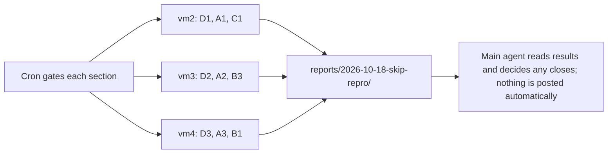

# Pool assignments: skip-audit reproductions and reviews, overnight 2026-10-18

Status: OPEN. This is one queue document. Each `##` section is one assignment with its own Status line. When cron gates a section, copy it to `assignments/` as its own file named by the section slug and post it under the usual rules in `pool/START-HERE.md`. Then set its Status line to CLAIMED or DONE in the same push as the claim or deliverable.

Source: `material/skip-audit/queue-current.json` (748 records with status `skip`). Audit verdicts on the branch cover only 38 of them (tier 2 and tier 4, audit-5 and audit-6); those 38 are left out. Earlier audit batches are not committed to the branch, so a claimant who finds a verdict for one of the other tickets should record it and skip the ticket.

Pinned head for every sweep and review: fork `origin/main` `498a09aea9` (2026-10-18). The skip notes name upstream/main at `c8ab71430f` (2026-10-17). A ticket verdict that depends on a commit between the two heads must name the commit.

## Host plan

| Host | Order | Notes |
| --- | --- | --- |
| vm2 | D1, A1, C1 | Open claims from 2026-10-16 have no heartbeat for more than two hours. This queue does not release them; the host owner does. |
| vm3 | D2, A2, B3 | Open claims: `pool-vm3-gate-backlog-16887` (00:50Z) and `pool-vm3-solr-13059-fix-round-1` (01:54Z). Finish or release these first. |
| vm4 | D3, A3, B1 | No open claims on coordination. |
| Any Linux host | B2, C2, C3, C4 | Open. Claim per WORKFLOW.md. |
| vm5 (coordinator) | Not handed off | Running SOLR-16430 (LocalFSCloudIncrementalBackupTest) and SOLR-5628 (TestDistribDocBasedVersion with the workaround line removed). Claim `pool-vm5-skip-repro-16430-5628-round-1`. |

Deferred, not assigned: 180 `awaitsfix/design` tickets with no named test (these are design items, not reproduction questions), and 11 `admin-ui` tickets (the Selenium suites run on the Windows host only).

## Common rules

- Sweep sections use one Gradle build at a time under the shared lock. Review sections run no builds.
- Results go into the deliverable as they finish. A stop keeps the partial results.
- Nothing is closed, commented, or posted to JIRA or GitHub from this queue.

## D1. Reproduce SOLR-8380 (CollectionsAPIDistributedZkTest 500 on proxied request), round 1

Status: OPEN

- Slug: `pool-skip-repro-8380-round-1`.
- Capability tags: sweep, review.
- Intended host: vm2 (first in its queue). Claim under `claims/` before starting.
- Posted by: vm5 (main agent coordinator), 2026-10-18, at the direction of Nick.

### Items

1. **Run the class.** Run `:solr:core:test --rerun --tests org.apache.solr.cloud.api.collections.CollectionsAPIDistributedZkTest` twice at the pinned head. Record each result and seed.
2. **Look for the signature.** In each log, search for `Response header too large`, `BufferOverflowException` and `Error trying to proxy request`. The ticket log shows Jetty `HttpGenerator.generateHeaders` failing. Record the matching lines with their line numbers.
3. **Read the proxy code.** Read `solr/core/src/java/org/apache/solr/servlet/HttpSolrProxy.java`, the `copyResponseHeaders` method. It copies every non-hop-by-hop response header from the remote node onto the local response. Record which headers a failing response carries, if the log shows them.
4. **Read the header limit.** Read `solr/server/etc/jetty.xml` for `requestHeaderSize` and `solr.jetty.request.header.size`. Record the default and whether a response-header limit is set anywhere. Do not change the file.

### Tickets

| Ticket | Test class | Gradle task | Note |
| --- | --- | --- | --- |
| SOLR-8380 | org.apache.solr.cloud.api.collections.CollectionsAPIDistributedZkTest | `:solr:core:test` | Ticket: fails about 1 in 3 runs on Jenkins (2015); did not reproduce locally in 2016. |

### Decisions

| Decision | Answer or default |
| --- | --- |
| Head | decided: the fork origin/main sha 498a09aea9 at posting time. Record the sha you ran. Do not move it. |
| Build protocol | decided: one Gradle build at a time under `flock /workspace/tools/.vm3-gradle.lock`. Record `df -h /` and `df -i /` before and after each run in the claim. |
| Worktree | decided: one detached worktree under `/workspace/worktrees/` at the pinned head. Do not reuse another session worktree. Never run bare `git stash`. |
| JDK and Gradle home | decided: the JDK and GRADLE_USER_HOME recorded in your host file under `hosts/`. Caches under /workspace only. |
| Run cadence | decided: run each class once with `--rerun`. If it fails, run it once more with the failing seed (pass the seed printed in the failing log as `-Ptests.seed`, written out in full). Stop at two runs per ticket. |
| Outcome recording | decided: record the test name, pass or fail, the assertion or exception line, the seed, the log path, and the XML path for each run. Do not interpret beyond that in this assignment. |
| Class not on main | default: record "not on main" and move to the next ticket; no other action. |
| Disk | default: if root filesystem free space falls under 2 GB, stop the sweep, record it, and escalate to the main agent. |
| Code changes | decided: none. No edits to main code or tests. The only commit is the deliverable file. |
| Closing or commenting | decided: none. Nothing is closed, commented or posted to JIRA or GitHub. Escalate any ticket that looks ready to close. |
| Scope | decided: the two runs and the reading in the items. No other classes. |
| Status of the 500 | default: if no run fails, record "no failure in 2 runs" and stop. Do not add runs. |

### Deliverable

`reports/2026-10-18-skip-repro/D1-8380.md`: run results, seeds, matching log lines with line numbers, and what the reading shows.

### Limits

- No PR, comment, JIRA or email. No force push.
- Commit as Nick Shanin with no trailers. No em dashes.

## D2. Reproduce SOLR-14159 (TestCloudConsistency connection failures), round 1

Status: OPEN

- Slug: `pool-skip-repro-14159-round-1`.
- Capability tags: sweep, review.
- Intended host: vm3 (first in its queue, after its open claims). Claim under `claims/` before starting.
- Posted by: vm5 (main agent coordinator), 2026-10-18, at the direction of Nick.

### Items

1. **Run the class.** Run `:solr:core:test --rerun --tests org.apache.solr.cloud.TestCloudConsistency` three times at the pinned head, one run at a time. Record each result and seed.
2. **Look for the signatures.** In each log, search for `Server refused connection`, `Timeout waiting for active collection`, and `404 Not Found` with `text/html`. Record the matching lines.
3. **Read the parent.** Check SOLR-13486 on JIRA (anonymous REST, read only). The ticket was moved from it. Record its current status and whether its description names the same race.

### Tickets

| Ticket | Test class | Gradle task | Note |
| --- | --- | --- | --- |
| SOLR-14159 | org.apache.solr.cloud.TestCloudConsistency | `:solr:core:test` | Erick Erickson reported 2 failures in about 1,000 runs on 2020-01-23 after commit 6b3e7feba1. Last comment 2020-04-14: no failures in four weeks. |

### Decisions

| Decision | Answer or default |
| --- | --- |
| Head | decided: the fork origin/main sha 498a09aea9 at posting time. Record the sha you ran. Do not move it. |
| Build protocol | decided: one Gradle build at a time under `flock /workspace/tools/.vm3-gradle.lock`. Record `df -h /` and `df -i /` before and after each run in the claim. |
| Worktree | decided: one detached worktree under `/workspace/worktrees/` at the pinned head. Do not reuse another session worktree. Never run bare `git stash`. |
| JDK and Gradle home | decided: the JDK and GRADLE_USER_HOME recorded in your host file under `hosts/`. Caches under /workspace only. |
| Run cadence | decided: run each class once with `--rerun`. If it fails, run it once more with the failing seed (pass the seed printed in the failing log as `-Ptests.seed`, written out in full). Stop at two runs per ticket. |
| Outcome recording | decided: record the test name, pass or fail, the assertion or exception line, the seed, the log path, and the XML path for each run. Do not interpret beyond that in this assignment. |
| Class not on main | default: record "not on main" and move to the next ticket; no other action. |
| Disk | default: if root filesystem free space falls under 2 GB, stop the sweep, record it, and escalate to the main agent. |
| Code changes | decided: none. No edits to main code or tests. The only commit is the deliverable file. |
| Closing or commenting | decided: none. Nothing is closed, commented or posted to JIRA or GitHub. Escalate any ticket that looks ready to close. |
| Scope | decided: the three runs and the reading in the items. |
| Failure found | default: record the failing test method, the first assertion or exception, and the seed. Do not diagnose further. |

### Deliverable

`reports/2026-10-18-skip-repro/D2-14159.md`: run results, seeds, matching lines, and the SOLR-13486 status.

### Limits

- No PR, comment, JIRA or email. No force push.
- Commit as Nick Shanin with no trailers. No em dashes.

## D3. Reproduce SOLR-5516 (ChaosMonkeyNothingIsSafeTest), round 1

Status: OPEN

- Slug: `pool-skip-repro-5516-round-1`.
- Capability tags: sweep, review.
- Intended host: vm4 (first in its queue). Claim under `claims/` before starting.
- Posted by: vm5 (main agent coordinator), 2026-10-18, at the direction of Nick.

### Items

1. **Run the class.** Run `:solr:core:test --rerun --tests org.apache.solr.cloud.ChaosMonkeyNothingIsSafeTest` once at the pinned head. It is long; allow the full run. Record the result and seed.
2. **Read the mitigation.** Read `solr/core/src/java/org/apache/solr/cloud/ShardLeaderElectionContext.java` around the `weAreReplacement` branch, where `Thread.sleep(2500)` waits before the replacement leader syncs. Record whether anything in the code confirms that in-flight updates from the old leader have finished, or whether the sleep is the only protection.
3. **Check the test.** In the run log, record any inconsistency assertion and the replica state it names.

### Tickets

| Ticket | Test class | Gradle task | Note |
| --- | --- | --- | --- |
| SOLR-5516 | org.apache.solr.cloud.ChaosMonkeyNothingIsSafeTest | `:solr:core:test` | Mark Miller (2013-12-06): the wait helps but is not enough on slow machines. |

### Decisions

| Decision | Answer or default |
| --- | --- |
| Head | decided: the fork origin/main sha 498a09aea9 at posting time. Record the sha you ran. Do not move it. |
| Build protocol | decided: one Gradle build at a time under `flock /workspace/tools/.vm3-gradle.lock`. Record `df -h /` and `df -i /` before and after each run in the claim. |
| Worktree | decided: one detached worktree under `/workspace/worktrees/` at the pinned head. Do not reuse another session worktree. Never run bare `git stash`. |
| JDK and Gradle home | decided: the JDK and GRADLE_USER_HOME recorded in your host file under `hosts/`. Caches under /workspace only. |
| Run cadence | decided: run each class once with `--rerun`. If it fails, run it once more with the failing seed (pass the seed printed in the failing log as `-Ptests.seed`, written out in full). Stop at two runs per ticket. |
| Outcome recording | decided: record the test name, pass or fail, the assertion or exception line, the seed, the log path, and the XML path for each run. Do not interpret beyond that in this assignment. |
| Class not on main | default: record "not on main" and move to the next ticket; no other action. |
| Disk | default: if root filesystem free space falls under 2 GB, stop the sweep, record it, and escalate to the main agent. |
| Code changes | decided: none. No edits to main code or tests. The only commit is the deliverable file. |
| Closing or commenting | decided: none. Nothing is closed, commented or posted to JIRA or GitHub. Escalate any ticket that looks ready to close. |
| Scope | decided: one run and the reading in the items. |
| Failure found | default: record the assertion and the replica state. Do not diagnose further. |

### Deliverable

`reports/2026-10-18-skip-repro/D3-5516.md`: run result, seed, the sleep reading, and any inconsistency record.

### Limits

- No PR, comment, JIRA or email. No force push.
- Commit as Nick Shanin with no trailers. No em dashes.
## A1. Reproduce flake tickets with named test classes, round 1

Status: OPEN

- Slug: `pool-skip-repro-flake-round-1`.
- Capability tags: sweep.
- Intended host: vm2. Claim under `claims/` before starting.
- Posted by: vm5 (main agent coordinator), 2026-10-18, at the direction of Nick.

### Items

1. **Run the tickets in the table.** For each row, run the Gradle task with the class from that row, following the Decisions table. Start from the pinned head. Output: one line per ticket in the deliverable.
2. **Record.** Write each ticket result into the deliverable file as it finishes, so a stop keeps partial results.

### Tickets

| Ticket | Test class (main) | Gradle task | Skip note (from queue) |
| --- | --- | --- | --- |
| SOLR-2865 | org.apache.solr.client.solrj.embedded.LargeVolumeBinaryJettyTest | `:solr:solrj:test` | test flake |
| SOLR-3220 | org.apache.solr.cloud.RecoveryZkTest | `:solr:core:test` | test flake |
| SOLR-5791 | org.apache.solr.handler.component.DistributedQueryElevationComponentTest | `:solr:core:test` | J9 test flake |
| SOLR-5792 | org.apache.solr.handler.component.TermVectorComponentDistributedTest | `:solr:core:test` | J9 test flake |
| SOLR-5793 | org.apache.solr.update.processor.SignatureUpdateProcessorFactoryTest | `:solr:core:test` | J9 test flake |
| SOLR-6287 | org.apache.solr.cloud.api.collections.CollectionsAPIDistributedZkTest | `:solr:core:test` | test flake |
| SOLR-7597 | org.apache.solr.TestRandomFaceting | `:solr:core:test` | test flake |
| SOLR-7992 | org.apache.solr.handler.component.QueryElevationComponentTest | `:solr:core:test` | test flake |
| SOLR-9144 | org.apache.solr.handler.TestReplicationHandler | `:solr:core:test` | test flake |
| SOLR-9328 | org.apache.solr.search.stats.TestDistribIDF | `:solr:core:test` | test flake |
| SOLR-9390 | org.apache.solr.cloud.LeaderFailoverAfterPartitionTest | `:solr:core:test` | test flake |
| SOLR-9427 | org.apache.solr.handler.TestReplicationHandler | `:solr:core:test` | test flake |
| SOLR-9428 | org.apache.solr.schema.TestManagedSchemaAPI | `:solr:core:test` | test flake, root cause in ZK read retry |
| SOLR-9965 | org.apache.solr.handler.TestReplicationHandler | `:solr:core:test` | test flake |
| SOLR-10592 | org.apache.solr.metrics.SolrCoreMetricManagerTest | `:solr:core:test` | test flake |
| SOLR-10759 | org.apache.solr.schema.TestUseDocValuesAsStored | `:solr:core:test` | test flake |
| SOLR-10841 | org.apache.solr.cloud.TestTlogReplica | `:solr:core:test` | test flake |
| SOLR-10976 | org.apache.solr.client.solrj.io.stream.StreamExpressionTest | `:solr:solrj-streaming:test` | Windows/jenkins test flake |
| SOLR-11058 | org.apache.solr.cloud.TestTlogReplica | `:solr:core:test` | Windows test flake |
| SOLR-11247 | org.apache.solr.common.cloud.TestCollectionStateWatchers | `:solr:solrj:test` | per session 2 handoff triage: flake, AwaitsFix on old branch, obsolete (Trie/EnumField removed), or design-level |
| SOLR-11463 | org.apache.solr.cloud.TestCloudSearcherWarming | `:solr:core:test` | test flake (TestCloudSearcherWarming on Jenkins 2017), test-infra only. |
| SOLR-11627 | org.apache.solr.cloud.AddReplicaTest | `:solr:core:test` | test flake (AddReplicaTest on Jenkins 2017); only debug logging was added, no product defect identified. |
| SOLR-11826 | org.apache.solr.security.TestPKIAuthenticationPlugin | `:solr:core:test` | test flake (TestPKIAuthenticationPlugin NPE, Jenkins 2018), test-infra only. |
| SOLR-12093 | org.apache.solr.cloud.LeaderVoteWaitTimeoutTest | `:solr:core:test` | test flake (LeaderVoteWaitTimeoutTest NPE in JettySolrRunner.getNodeName), nightly Jenkins 2018; test-infra only, no ... |
| SOLR-12302 | org.apache.solr.cloud.BasicDistributedZkTest | `:solr:core:test` | ant-era BasicDistributedZkTest seed failures (2018); ant build gone, test flake |
| SOLR-12844 | org.apache.solr.handler.component.TestDistributedStatsComponentCardinality | `:solr:core:test` | stale 2018 7.x nightly test flake, 0 comments, no triage, no repro on current main |
| SOLR-14881 | org.apache.solr.schema.ManagedSchemaRoundRobinCloudTest | `:solr:core:test` | Stale 2020 test-flake ticket; Noble Paul's fix commit already in the tree, ticket left Open |
| SOLR-16094 | org.apache.solr.handler.TestSolrConfigHandlerCloud | `:solr:core:test` | stale 2022 test-flake: TestSolrConfigHandlerCloud hang on OSX, no comments, never reproduced |

### Decisions

| Decision | Answer or default |
| --- | --- |
| Head | decided: the fork origin/main sha 498a09aea9 at posting time. Record the sha you ran. Do not move it. |
| Build protocol | decided: one Gradle build at a time under `flock /workspace/tools/.vm3-gradle.lock`. Record `df -h /` and `df -i /` before and after each run in the claim. |
| Worktree | decided: one detached worktree under `/workspace/worktrees/` at the pinned head. Do not reuse another session worktree. Never run bare `git stash`. |
| JDK and Gradle home | decided: the JDK and GRADLE_USER_HOME recorded in your host file under `hosts/`. Caches under /workspace only. |
| Run cadence | decided: run each class once with `--rerun`. If it fails, run it once more with the failing seed (pass the seed printed in the failing log as `-Ptests.seed`, written out in full). Stop at two runs per ticket. |
| Outcome recording | decided: record the test name, pass or fail, the assertion or exception line, the seed, the log path, and the XML path for each run. Do not interpret beyond that in this assignment. |
| Class not on main | default: record "not on main" and move to the next ticket; no other action. |
| Disk | default: if root filesystem free space falls under 2 GB, stop the sweep, record it, and escalate to the main agent. |
| Code changes | decided: none. No edits to main code or tests. The only commit is the deliverable file. |
| Closing or commenting | decided: none. Nothing is closed, commented or posted to JIRA or GitHub. Escalate any ticket that looks ready to close. |
| Scope | decided: only the rows in this table. |

### Deliverable

`reports/2026-10-18-skip-repro/A1-flake-round-1.md`: one row per ticket with the run results, seeds, and XML paths.

### Limits

- No PR, comment, JIRA or email. No force push.
- Commit as Nick Shanin with no trailers. No em dashes.

## A2. Locate and reproduce flake tickets without a named class, round 1

Status: OPEN

- Slug: `pool-skip-repro-flake-locate-round-1`.
- Capability tags: sweep.
- Intended host: vm3 (after its open claims are done). Claim under `claims/` before starting.
- Posted by: vm5 (main agent coordinator), 2026-10-18, at the direction of Nick.

### Items

1. **Run the tickets in the table.** For each row, run the Gradle task with the class from that row, following the Decisions table. Start from the pinned head. Output: one line per ticket in the deliverable.
2. **Record.** Write each ticket result into the deliverable file as it finishes, so a stop keeps partial results.

### Tickets

| Ticket | Test class (main) | Gradle task | Skip note (from queue) |
| --- | --- | --- | --- |
| SOLR-2715 | locate from the JIRA description (anonymous REST, read only) | per class | test flake |
| SOLR-2720 | locate from the JIRA description (anonymous REST, read only) | per class | test flake |
| SOLR-3944 | locate from the JIRA description (anonymous REST, read only) | per class | OOM with huge docs in Solr Cell, environment |
| SOLR-5948 | locate from the JIRA description (anonymous REST, read only) | per class | test flake (LUCENE-5574) |
| SOLR-6593 | locate from the JIRA description (anonymous REST, read only) | per class | test flake |
| SOLR-6914 | locate from the JIRA description (anonymous REST, read only) | per class | test timeout flake |
| SOLR-7646 | locate from the JIRA description (anonymous REST, read only) | per class | OOM wrapping, general, no concrete fix |
| SOLR-9182 | locate from the JIRA description (anonymous REST, read only) | per class | test infra OOM investigation, resolved via SOLR-9604 |
| SOLR-9426 | locate from the JIRA description (anonymous REST, read only) | per class | test flake |
| SOLR-11168 | locate from the JIRA description (anonymous REST, read only) | per class | test flake (ConcurrentUpdateSolrClientTest timing), no repro |
| SOLR-11193 | locate from the JIRA description (anonymous REST, read only) | per class | per session 2 handoff triage: flake, AwaitsFix on old branch, obsolete (Trie/EnumField removed), or design-level |
| SOLR-11208 | locate from the JIRA description (anonymous REST, read only) | per class | per session 2 handoff triage: flake, AwaitsFix on old branch, obsolete (Trie/EnumField removed), or design-level |
| SOLR-11214 | locate from the JIRA description (anonymous REST, read only) | per class | per session 2 handoff triage: flake, AwaitsFix on old branch, obsolete (Trie/EnumField removed), or design-level |
| SOLR-11259 | locate from the JIRA description (anonymous REST, read only) | per class | per session 2 handoff triage: flake, AwaitsFix on old branch, obsolete (Trie/EnumField removed), or design-level |
| SOLR-12220 | locate from the JIRA description (anonymous REST, read only) | per class | Windows-only test cleanup flake (ant era) |
| SOLR-12369 | locate from the JIRA description (anonymous REST, read only) | per class | beasting flake in ZkController.waitForShardId (Dat), no deterministic repro; not a user-visible bug on main |
| SOLR-12748 | locate from the JIRA description (anonymous REST, read only) | per class | stale 2018 OOM incident, never reproduced; 2018 code path (remoteQuery) gone from main; thread-pileup on hung peer is... |
| SOLR-18007 | locate from the JIRA description (anonymous REST, read only) | per class | SKIP: maintainer (Smiley) investigation ticket, no repro, no comments, no fix direction; lookup-reload flake needs bi... |

### Decisions

| Decision | Answer or default |
| --- | --- |
| Head | decided: the fork origin/main sha 498a09aea9 at posting time. Record the sha you ran. Do not move it. |
| Build protocol | decided: one Gradle build at a time under `flock /workspace/tools/.vm3-gradle.lock`. Record `df -h /` and `df -i /` before and after each run in the claim. |
| Worktree | decided: one detached worktree under `/workspace/worktrees/` at the pinned head. Do not reuse another session worktree. Never run bare `git stash`. |
| JDK and Gradle home | decided: the JDK and GRADLE_USER_HOME recorded in your host file under `hosts/`. Caches under /workspace only. |
| Run cadence | decided: run each class once with `--rerun`. If it fails, run it once more with the failing seed (pass the seed printed in the failing log as `-Ptests.seed`, written out in full). Stop at two runs per ticket. |
| Outcome recording | decided: record the test name, pass or fail, the assertion or exception line, the seed, the log path, and the XML path for each run. Do not interpret beyond that in this assignment. |
| Class not on main | default: record "not on main" and move to the next ticket; no other action. |
| Disk | default: if root filesystem free space falls under 2 GB, stop the sweep, record it, and escalate to the main agent. |
| Code changes | decided: none. No edits to main code or tests. The only commit is the deliverable file. |
| Closing or commenting | decided: none. Nothing is closed, commented or posted to JIRA or GitHub. Escalate any ticket that looks ready to close. |
| Locate | default: if the JIRA description names no test class, record "no test named" and escalate to the main agent. Do not pick a test by guessing. |
| Scope | decided: only the rows in this table. |

### Deliverable

`reports/2026-10-18-skip-repro/A2-flake-locate-round-1.md`: one row per ticket with the class found, run results and seeds.

### Limits

- No PR, comment, JIRA or email. No force push.
- Commit as Nick Shanin with no trailers. No em dashes.

## A3. Reproduce non-flake tickets with named test classes, round 1

Status: OPEN

- Slug: `pool-skip-repro-other-round-1`.
- Capability tags: sweep.
- Intended host: vm4. Claim under `claims/` before starting.
- Posted by: vm5 (main agent coordinator), 2026-10-18, at the direction of Nick.

### Items

1. **Run the tickets in the table.** For each row, run the Gradle task with the class from that row, following the Decisions table. Start from the pinned head. Output: one line per ticket in the deliverable.
2. **Record.** Write each ticket result into the deliverable file as it finishes, so a stop keeps partial results.

### Tickets

| Ticket | Test class (main) | Gradle task | Skip note (from queue) |
| --- | --- | --- | --- |
| SOLR-2900 | org.apache.solr.core.TestCoreContainer | `:solr:core:test` | test hygiene |
| SOLR-2928 | org.apache.solr.update.TestIndexingPerformance | `:solr:core:test` | test leaves write.lock, old |
| SOLR-3461 | org.apache.solr.search.TestRealTimeGet | `:solr:core:test` | test slowness on Windows |
| SOLR-4139 | org.apache.solr.handler.TestReplicationHandler | `:solr:core:test` | test with preventDoubleWrite, old |
| SOLR-5067 | org.apache.solr.handler.TestReplicationHandler | `:solr:core:test` | test cleanup |
| SOLR-5485 | org.apache.solr.cloud.ChaosMonkeySafeLeaderTest | `:solr:core:test` | very rare lucene corruption in test |
| SOLR-7075 | org.apache.solr.handler.TestConfigReload | `:solr:core:test` | revisited in spot-check: 2015 Jenkins failure of TestConfigReload.checkConfReload, 1 comment, only stack trace + atta... |
| SOLR-7899 | org.apache.solr.handler.sql.TestSQLHandler | `:solr:modules:sql:test` | non-reproducible test failure |
| SOLR-11274 | org.apache.solr.ltr.feature.TestEdisMaxSolrFeature | `:solr:modules:ltr:test` | LTR test config problem in reporter's environment (unknown field description); test-infra. |
| SOLR-12296 | org.apache.solr.update.processor.TimeRoutedAliasUpdateProcessorTest | `:solr:core:test` | flaky test (TimeRoutedAliasUpdateProcessorTest, 2018 jenkins), no deterministic repro |
| SOLR-12819 | org.apache.solr.schema.TestPointFields | `:solr:core:test` | stale 8-yr-old seeded test failure report (TestPointFields sort), zero comments, no confirmed product bug, maintainer... |
| SOLR-12918 | org.apache.solr.spelling.suggest.TestHighFrequencyDictionaryFactory | `:solr:core:test` | Stale 2018 test-infra issue; crashing code is upstream Lucene test-framework code, not in the Solr repo; zero comment... |
| SOLR-14784 | org.apache.solr.update.DirectUpdateHandlerTest | `:solr:core:test` | stale 2020 test-only flaky-test ticket; root cause diagnosed in-thread (LUCENE-9456), assertion rewritten on current ... |
| SOLR-17133 | org.apache.solr.client.solrj.io.stream.CloudAuthStreamTest | `:solr:solrj-streaming:test` | test-only failure under PRS mode; empty description, 0 comments; reporter/assignee is Noble Paul (self-assigned maint... |
| SOLR-4593 | org.apache.solr.cloud.api.collections.CollectionsAPIDistributedZkTest | `:solr:core:test` | test flake, fixed 4.9/6.0 |
| SOLR-5822 | org.apache.solr.cloud.ChaosMonkeyNothingIsSafeTest | `:solr:core:test` | chaos monkey test finding, fixed 4.9/6.0 |
| SOLR-9593 | org.apache.solr.cloud.api.collections.ConcurrentDeleteAndCreateCollectionTest | `:solr:core:test` | test flake, fixed 6.7/7.0 |
| SOLR-11563 | org.apache.solr.schema.TestCloudSchemaless | `:solr:core:test` | test failure already fixed by a follow-up commit per SOLR-11484 discussion; reporter confirmed. |
| SOLR-13486 | org.apache.solr.cloud.TestTlogReplayVsRecovery | `:solr:core:test` | design-heavy 2019 tlog-replay vs recovery race; needs maintainer design consensus, no assignee/PR in 7 years |
| SOLR-14061 | org.apache.solr.cloud.api.collections.TestLocalFSCloudBackupRestore | `:solr:core:test` | Stale 2019 ticket: speculative corruption report triggered by SecurityManager-era AccessControlException from Files.e... |
| SOLR-16122 | org.apache.solr.cloud.TestLeaderElectionZkExpiry | `:solr:core:test` | stale 2022 flaky-test ticket (BadApple-mitigated, still AwaitsFix on main); thread-leak test infra, no product bug; s... |

### Decisions

| Decision | Answer or default |
| --- | --- |
| Head | decided: the fork origin/main sha 498a09aea9 at posting time. Record the sha you ran. Do not move it. |
| Build protocol | decided: one Gradle build at a time under `flock /workspace/tools/.vm3-gradle.lock`. Record `df -h /` and `df -i /` before and after each run in the claim. |
| Worktree | decided: one detached worktree under `/workspace/worktrees/` at the pinned head. Do not reuse another session worktree. Never run bare `git stash`. |
| JDK and Gradle home | decided: the JDK and GRADLE_USER_HOME recorded in your host file under `hosts/`. Caches under /workspace only. |
| Run cadence | decided: run each class once with `--rerun`. If it fails, run it once more with the failing seed (pass the seed printed in the failing log as `-Ptests.seed`, written out in full). Stop at two runs per ticket. |
| Outcome recording | decided: record the test name, pass or fail, the assertion or exception line, the seed, the log path, and the XML path for each run. Do not interpret beyond that in this assignment. |
| Class not on main | default: record "not on main" and move to the next ticket; no other action. |
| Disk | default: if root filesystem free space falls under 2 GB, stop the sweep, record it, and escalate to the main agent. |
| Code changes | decided: none. No edits to main code or tests. The only commit is the deliverable file. |
| Closing or commenting | decided: none. Nothing is closed, commented or posted to JIRA or GitHub. Escalate any ticket that looks ready to close. |
| Scope | decided: only the rows in this table. Fixed-in-version rows are checks on main, not fixes. |

### Deliverable

`reports/2026-10-18-skip-repro/A3-other-round-1.md`: one row per ticket with the run results, seeds and XML paths.

### Limits

- No PR, comment, JIRA or email. No force push.
- Commit as Nick Shanin with no trailers. No em dashes.

## B1. Verify removed-feature tickets, round 1

Status: OPEN

- Slug: `pool-skip-review-removed-round-1`.
- Capability tags: review.
- Intended host: vm4 (after A3), or any Linux host. Claim under `claims/` before starting.
- Posted by: vm5 (main agent coordinator), 2026-10-18, at the direction of Nick.

### Items

1. **Check each ticket.** For each row, apply the Method in the Decisions table and record the verdict. Output: one row per ticket in the deliverable.
2. **Record.** Write results into the deliverable as you go, so a stop keeps partial results. Name any ticket you did not reach.

### Tickets

| Ticket | Summary | Skip note (from queue) | Verdict |
| --- | --- | --- | --- |
| SOLR-1658 | Negative query weirdness | obsolete: nested pure negative with AND is handled (TestSolrQueryParser ~L1936) | |
| SOLR-2976 | stats.facet no longer works on single valued trie fields that don't use precision step | Trie precision step stats, removed | |
| SOLR-3064 | Solrj sets no content type on ContentStreamUpdateRequest.addFile | obsolete: ContentStreamUpdateRequest removed | |
| SOLR-3124 | explain output is confusing when using trie fields (or any field type where the indexed terms are... | explain readability for Trie, Trie removed | |
| SOLR-3201 | Recurrence resolver into VariableResolver | DIH removed | |
| SOLR-4113 | Fullpath for db-config file causes error on SolrCloud | DIH removed | |
| SOLR-4183 | The "clean" parameter in DataImport causes the other nodes to empty and commit before indexing is... | DIH removed | |
| SOLR-4382 | edismax, qf, multiterm analyzer, wildcard query bug | obsolete: edismax validates qf fields (validateQueryFields) | |
| SOLR-4390 | SolrJ does not URL-encode query string argument names but should | obsolete: SolrParams.toQueryString URL-encodes names | |
| SOLR-4522 | SimpleFacets.getListedTermCounts wont work for docvalues-only fields (or other custom fieldtypes) | 4.x docvalues facet refinement term query; Trie/points reworked | |
| SOLR-4610 | Calling query.toString will print binary values for encoded integer values in terms. | query toString display of encoded ints, Trie removed | |
| SOLR-5383 | Group Faceting does not play nice with Trie fields that use precsionStep | Trie precisionStep with group.facet, Trie removed | |
| SOLR-5717 | group.field returns no groups for trie fields with non zero precisionstep | Trie field with precisionStep, removed | |
| SOLR-6142 | Solr Core pom.xml should not depend on Jetty and others | build/pom dependency scope, obsolete (Gradle) | |
| SOLR-6166 | HttpSolrServer does not properly implement the Serializable interface | HttpSolrServer serialization, old class removed | |
| SOLR-6303 | JDBC drivers not being released causing permgen memory leak | JDBC leak with DIH, removed | |
| SOLR-6395 | If the overseer queue is large, then the cloud tree view (admin UI) hangs | Admin UI angular, obsolete | |
| SOLR-6875 | No data integrity between replicas | 4.10 replica inconsistency, LIR era, obsolete | |
| SOLR-7009 | Body of a request does not print out in XMLLoader when setting log level to TRACE | obsolete: XMLLoader trace log removed/changed | |
| SOLR-7221 | ConcurrentUpdateSolrServer does not work with HttpClientBuilder (4.3.1) | 4.3 SolrJ client migration, obsolete | |
| SOLR-7517 | When you can't persist a core.properties file we simply log an error and continue. | obsolete: CorePropertiesLocator throws on persist failure | |
| SOLR-7773 | Can not overwrite mem settings with env variable | bin/solr env override, obsolete script | |
| SOLR-7953 | BaseEditorialTransformer (elevated) doesn't work with LazyField | obsolete: getKey uses IndexableField.stringValue, which LazyField supports | |
| SOLR-7998 | Solr start/stop script is currently incompatible with SUSE 11 | bin/solr script on SUSE 11, obsolete | |
| SOLR-8024 | Json facet api fails on multivalue trieint with docvalues | 5.3 Trie field, removed | |
| SOLR-8076 | SEVERE: Unable to load Transformer: foo.FieldTransformer | DIH removed | |
| SOLR-8087 | Look into defensive check in publish that will not let a replica in LIR publish ACTIVE. | LIR removed, obsolete | |
| SOLR-8089 | Support query parsers being able to set enablePositionIncrements | enablePositionIncrements removed in Lucene; design | |
| SOLR-8158 | Analytics module not supporting multi-valued int values | analytics component removed | |
| SOLR-8463 | FacetComponent throws NPE when using shards.tolerant and a shard fails to respond | obsolete: FacetComponent.countFacets skips shards without facet_counts | |
| SOLR-8843 | Missing fallback for NoChildrenForEphemeralsException on ZkController.getLeaderPropsWithFallback ... | 5.4 rolling upgrade fallback, obsolete | |
| SOLR-8991 | UI: Ping option doesn't update menu with response time if it's 0ms | Admin UI angular, obsolete | |
| SOLR-9094 | ReRanker should gracefully handle sorts without score | 4.10.4 reranker config, obsolete | |
| SOLR-9126 | shutdownAndAwaitTermination interruption handling faulty? | obsolete: ExecutorUtil.awaitTermination now handles interrupt | |
| SOLR-9202 | UninvertingReader needs multi-valued points support | UninvertingReader points, moot (Lucene removed) | |
| SOLR-9267 | Cloud MLT field boost not working | obsolete: AbstractMLTQParser now parses field boosts with SolrPluginUtils.parseFieldBoosts | |
| SOLR-9366 | replicas in LIR seem to still be participating in search requests | LIR removed, committed fixes | |
| SOLR-9400 | Casting error when using SortedMapBackedCache | DIH removed from Solr core | |
| SOLR-9677 | edismax treat operator as a keyword when a query parameter 'qf' contains inexist field. | obsolete: ExtendedDismaxQParser.validateQueryFields fails on unknown qf fields | |
| SOLR-9749 | /admin/plugins endpoint doesn't have a paramset in ImplicitPlugins.json | obsolete: /admin/plugins not in ImplicitPlugins.json on main | |
| SOLR-9809 | TrieField.createFields produces useless IndexableField instances when field is stored=false index... | TrieField removed | |

### Decisions

| Decision | Answer or default |
| --- | --- |
| Head | decided: the fork origin/main sha 498a09aea9 at posting time. Record the sha you read. Do not move it. |
| Method | decided: read the ticket description (anonymous JIRA REST at issues.apache.org/jira/rest/api/2/issue/KEY, read only), then check the named code path on the pinned head with `git grep` or `git show`. Cite file path and line. |
| Verdict set | decided: exactly one of: gone (cite the removal or the grep showing no hits), present (cite the code path still there), fixed (cite the commit that changed it), unclear (say what is missing). No other verdicts. |
| Unclear | default: mark unclear and state the missing piece; do not guess a verdict. |
| Gradle | decided: none. No builds or test runs in a review item. |
| Closing or commenting | decided: none. No JIRA, GitHub or email posts. |
| Scope | decided: the rows in this table. |

### Deliverable

`reports/2026-10-18-skip-repro/B1-removed-round-1.md`: one row per ticket with verdict and the cited path or grep.

### Limits

- No PR, comment, JIRA or email. No force push.
- Commit as Nick Shanin with no trailers. No em dashes.

## B2. Verify removed-feature tickets, round 2

Status: OPEN

- Slug: `pool-skip-review-removed-round-2`.
- Capability tags: review.
- Intended host: open, any Linux host. Claim under `claims/` before starting.
- Posted by: vm5 (main agent coordinator), 2026-10-18, at the direction of Nick.

### Items

1. **Check each ticket.** For each row, apply the Method in the Decisions table and record the verdict. Output: one row per ticket in the deliverable.
2. **Record.** Write results into the deliverable as you go, so a stop keeps partial results. Name any ticket you did not reach.

### Tickets

| Ticket | Summary | Skip note (from queue) | Verdict |
| --- | --- | --- | --- |
| SOLR-9826 | Shutting down leader when it's sending updates makes another active node go into recovery | LIR removed, executor no longer interrupted | |
| SOLR-9872 | raf.setLength(0) in transactionLog is unreachable | obsolete: TransactionLog constructor rewritten | |
| SOLR-9913 | LIR should continue on SocketTimeoutException | LIR removed from Solr 9+, obsolete | |
| SOLR-10041 | Leader Initiated Recovery happening when the leader also fails to index the content | LIR removed from Solr 9+, obsolete | |
| SOLR-10201 | Admin UI: Add Collection "creates collection", "Connection to Solr lost", when replicationFactor1 | Admin UI angular, obsolete | |
| SOLR-10326 | AutoAddReplicas should use previous state to populate shared data dirs if SolrCore is not available. | autoAddReplicas rewritten; obsolete | |
| SOLR-10497 | angular error - ngRepeat:dupes. Prevents proper page loading. | Admin UI angular, obsolete UI | |
| SOLR-10511 | Unable to view replication status | Admin UI angular, obsolete UI | |
| SOLR-10709 | get "unexpected docvalues type NUMERIC for field" for query q=field:* if field is defined as docV... | obsolete: Trie gone; PointField/FieldType use existence queries for field:* | |
| SOLR-10889 | Stale zookeper information is used during failover check | obsolete: OverseerAutoReplicaFailoverThread removed (autoAddReplicas rewrite) | |
| SOLR-10904 | Unnecessary waiting during failover in case of failed core creation | obsolete: failover thread replaced by autoAddReplicas rewrite | |
| SOLR-10959 | o.a.s.c.MapSerializable missing in solr-core maven artifact | packaging question for 6.6, obsolete | |
| SOLR-11009 | FacetModule throws NullPointerException when all shard requests fail with shards.tolerant=true | obsolete: FacetModule now null-checks mcontext and merger when all shards fail | |
| SOLR-11246 | MoveReplica API does not preserve replica type information | obsolete: MoveReplicaCmd on main already passes REPLICA_TYPE (lines 247, 370) | |
| SOLR-11378 | Solr can leak transaction logs if a commit happens during unload | no repro/isolating test; autoscaling test removed; similar to SOLR-15695 (core unload vs commit tlog leak);... | |
| SOLR-11435 | Replicas failed to be deleted can overwrite replicas of recreated collections | obsolete: legacyCloud/baseUrl-comparison model was removed from SolrCloud; ticket scenario (deleted replica... | |
| SOLR-11537 | Add Replica after upgrading from Solr 6.2.1 to Solr 7.1.0 throws InvalidClassException | obsolete: Overseer no longer uses Java serialization for SolrResponse (SimpleOrderedMap serialVersionUID mi... | |
| SOLR-11659 | JMX Metrics ObjectName needs comma escaping for /solr/col1,col2/select scenario | obsolete: JMX metrics reporter (JmxObjectNameFactory) no longer exists on main. | |
| SOLR-11776 | HttpSolrClient should handle SocketException:broken pipe | obsolete: leader-initiated recovery (LIR) was removed from SolrCloud; broken-pipe handling premise no longe... | |
| SOLR-11787 | StackOverflowError in leader election | no repro; log4j-frame StackOverflowError in 7.1 leader election, probable duplicate of SOLR-6213; LIR/elect... | |
| SOLR-11955 | Clean up usage of graph token filters in shipped schemas | obsolete: no shipped non-test schema/configset on main chains SynonymGraphFilter into WordDelimiterGraphFil... | |
| SOLR-12166 | Race condition in rejoinElection and registering replica | revisited in session 3: LIR/election race, LIR removed in Solr 9 | |
| SOLR-12446 | Misleading client response when IllegalArgumentException is thrown in SolrIndexSearcher | partly obsolete / design call: LBSolrClient on main already chains the real shard exception as the cause of... | |
| SOLR-12585 | Solr fails even ZK quorum has majority | obsolete: ZK 3.4 client DNS behavior; ZK 3.9 HostProvider skips unresolvable hosts | |
| SOLR-12645 | MemClassLoader#loadResource() is broken | obsolete: MemClassLoader class no longer exists on main (no file match); plugin loading rewritten | |
| SOLR-12646 | Splitting a shard that has been touched by 6x fails with 7x. | obsolete: 6.x-7.x upgrade path, autoscaling Variable$Type NoClassDefFound; autoscaling removed in 9.x, 6.x ... | |
| SOLR-13304 | PreanalyzedField#createField swallows Exception | target code removed: PreanalyzedField deleted via SOLR-17839; reporter/assignee had a 2019 patch, 7+ yrs stale | |
| SOLR-13481 | Re-try of solr request will not happen with different live servers, if one request throws Exception | Stale: target class LBHttpSolrClient no longer exists on main (removed via SOLR-17962/SOLR-18188); retry lo... | |
| SOLR-13501 | Use Http2SolrClient in DUP and remove ConcurrentUpdateHttp2SolrClient. | already-removed class; 2019 maintainer refactoring proposal, benchmark-gated, design-heavy | |
| SOLR-13846 | PreemptiveBasicAuthClientBuilderFactory use of static code blocks makes it unreliable in tests | Stale: subject class PreemptiveBasicAuthClientBuilderFactory was removed from the codebase (deleted by SOLR... | |
| SOLR-14023 | tests.src.home points at ${user.dir}" for tests (?!) | Design-heavy test-infra redesign proposal from active maintainer Dawid Weiss (2019, stale); the user.dir de... | |
| SOLR-14117 | remove java serialization from AnalyticsShardResponseParser.java | stale: AnalyticsShardResponseParser removed with analytics component (SOLR-16661); no ObjectInputStream lef... | |
| SOLR-15297 | Creating a collection with TLOG replicas fails with placement rules | feature for deprecated rules framework; obsolete - placement-plugin framework (current main) already places... | |
| SOLR-15310 | HttpClientUtil interceptors are shared by multiple CoreContainer in same Test JVM | Obsolete/stale: HttpClientUtil static interceptor registry no longer exists in current main (removed by Jet... | |
| SOLR-15350 | fieldCache stats contain entries for other things (a regression) | stale: /admin/mbeans removed from main by SOLR-17853 (Oct 2025); buggy SolrInfoMBeanHandler code no longer ... | |
| SOLR-15690 | Updates in datasource.xml are not reflecting in Solr Console | Stale DIH ticket: DataImportHandler removed in Solr 9 (no code surface on current main); 0 comments, no rep... | |
| SOLR-15704 | Delta import with multiple entities: working partially | stale: DataImportHandler removed from Solr 9; no fix possible in this repo | |
| SOLR-15879 | Memory leak in QueryResultsCache | stale: FastLRUCache maxRamMB-honoring bug on Solr 7.5; class removed from main in 9.x, no repro confirmatio... | |
| SOLR-17763 | Solr container was not available: CoreContainer is either not initialized or shutting down | stale symptom report on 9.6.1; no comments, no repro; reported latch-wait code path removed by SOLR-17118 i... | |
| SOLR-17993 | SolrCoreMetric.CLOUD_CORE_PATTERN does not support split shards | obsolete on main: SolrCoreMetric/CLOUD_CORE_PATTERN gone after OTel metrics refactor; see research note | |

### Decisions

| Decision | Answer or default |
| --- | --- |
| Head | decided: the fork origin/main sha 498a09aea9 at posting time. Record the sha you read. Do not move it. |
| Method | decided: read the ticket description (anonymous JIRA REST at issues.apache.org/jira/rest/api/2/issue/KEY, read only), then check the named code path on the pinned head with `git grep` or `git show`. Cite file path and line. |
| Verdict set | decided: exactly one of: gone (cite the removal or the grep showing no hits), present (cite the code path still there), fixed (cite the commit that changed it), unclear (say what is missing). No other verdicts. |
| Unclear | default: mark unclear and state the missing piece; do not guess a verdict. |
| Gradle | decided: none. No builds or test runs in a review item. |
| Closing or commenting | decided: none. No JIRA, GitHub or email posts. |
| Scope | decided: the rows in this table. |

### Deliverable

`reports/2026-10-18-skip-repro/B2-removed-round-2.md`: one row per ticket with verdict and the cited path or grep.

### Limits

- No PR, comment, JIRA or email. No force push.
- Commit as Nick Shanin with no trailers. No em dashes.

## B3. Verify already-committed and support-question tickets

Status: OPEN

- Slug: `pool-skip-review-committed-support-round-1`.
- Capability tags: review.
- Intended host: vm3 (after A2), or any Linux host. Claim under `claims/` before starting.
- Posted by: vm5 (main agent coordinator), 2026-10-18, at the direction of Nick.

### Items

1. **Check each ticket.** For each row, apply the Method in the Decisions table and record the verdict. Output: one row per ticket in the deliverable.
2. **Record.** Write results into the deliverable as you go, so a stop keeps partial results. Name any ticket you did not reach.

### Tickets

| Ticket | Summary | Skip note (from queue) | Verdict |
| --- | --- | --- | --- |
| SOLR-7352 | Synchronize CloudSolrStream EOF Tuple Map | already committed | |
| SOLR-8899 | MergeStrategy code creates HttpClient(s) and HttoSolrClient(s) that it does not close | already committed | |
| SOLR-10601 | StreamExpressionParser should handle white space around = in named parameters | already committed | |
| SOLR-11269 | Node gone after reconnecting to ZK | already addressed on main: ZkController catches NodeExistsException when re-creating the ephemeral live node. | |
| SOLR-11550 | 'addChildDocument' does not maintain the atomicity | already addressed by SOLR-10114 (shared _version_ for parent/children); reporter's repro not reproducible; ... | |
| SOLR-11864 | Create Collection API allows creating collection with trailing space | already handled on main: collection names go through SolrIdentifierValidator.validateCollectionName (Create... | |
| SOLR-12236 | Admin UI logging page: "Core" column never gets populated | revisited in session 3: Admin UI log Core column; Log4j2Watcher.toSolrDocument already copies the core MDC ... | |
| SOLR-13278 | Using multiple dictionaries with Solr Suggester | stale 2019 support question, ill-defined; multi-dict querying already works on main | |
| SOLR-13572 | NullPointerException leads to msg=null. | stale 2019 NPE-report; no repro, reporter never answered Jan's 8.x retest; NPE path already null-guarded in... | |
| SOLR-13616 | Possible racecondition/deadlock between collection DELETE and PrepRecovery ? (TestPolicyCloud fai... | design-heavy, reporter is active maintainer (Hostetter) with open design questions, 7yr stale, main already... | |
| SOLR-15801 | Ref Guide docs on Java support out of date | documentation-only (system_requirements.adoc Java matrix), stale - 2021 text already rewritten in current g... | |
| SOLR-15970 | Release Wizard must clean up staging artifacts after a failed RC | already addressed on main (abort flows already svn-rm staging artifacts since 2022-01-14), 0 comments since... | |
| SOLR-16077 | Solr basic authentication is a bit strange | Not a user-facing bug per Jan Høydahl; double-SHA256 hashing is a deliberate per-request scheme, changing i... | |
| SOLR-17224 | Getting NPE in apache SOLR 8.11.2 while doing atomic update using add-distinct from java based ap... | duplicate of SOLR-17721; doAddDistinct NPE null-check already on main (a1ebd0433c7) | |
| SOLR-17820 | Shard and Collection health is GREEN with down replicas | Not reproducible on current main: calcShardHealth already yields YELLOW for 1-down-of-5 with leader; logic ... | |
| SOLR-3742 | group.func and group.facet do not work together | group.func with group.facet unsupported | |
| SOLR-5772 | duplicate documents between solr "block join" documents and "normal" document | mixing block join and normal docs unsupported, per maintainers | |
| SOLR-5845 | File locked after indexing | 4.6 file lock after indexing, support | |
| SOLR-6334 | Solr node(cores) go into recovering state and peersync failed | 4.7 recovery, support | |
| SOLR-6588 | Combination of nested documents and incremental partial update on int field does not work | nested docs with atomic update unsupported combination | |
| SOLR-7363 | Expand component throws an Exception when the results have been collapsed and grouped | expand with grouping unsupported combination, feature | |
| SOLR-7526 | When replacing index contents and reloading the core, index is deleted | 5.1 replace index files then RELOAD, unsupported workflow | |
| SOLR-7947 | SolrCloud: after a solr node restarted, all cores in the node are down in /clusterstate.json due ... | 4.7 overlapping file lock, support | |
| SOLR-9713 | TLS-SSL Mutual-Auth doesn't work, Unable to load keyStore with given password | keystore password handling on Windows script, 6.2.1 support | |
| SOLR-10096 | Parallel SQL not returning the correct results for count distinct aggregation | feature: count distinct unsupported in old SQL handler | |
| SOLR-10974 | Replication - Unable to download tlog | support question, no repro (user list) | |
| SOLR-11175 | FuzzyLookupFactory with DocumentDictionaryFactory returns only one result for document | vague suggester config/support question, no clear defect | |
| SOLR-11290 | replace expression doesn't allow strings | not reproducible by reading main: ReplaceWithValueOperation supports string originals/values and documents ... | |
| SOLR-11764 | preanalyzed field with highlight option throws exception | support question solved in-ticket (storeOffsetsWithPositions for PreAnalyzedField highlighting); not a bug. | |
| SOLR-13167 | Duplicate Child Documents and undeterministic search | stale 2019 nested-child-docs support ticket: no comments, no repro, no assignee; likely pipeline re-ingesti... | |
| SOLR-13825 | AccessDeniedException \server\solr\custom_master_index\data\index\_jh7m_Lucene50_0.pos | Stale 2019 Windows/Azure support question: AccessDeniedException during Lucene FSDirectory fsync is OS file... | |
| SOLR-14083 | Solr GUI access through Internet Explorer | stale 2019 IE11-only Admin UI login issue; Jan Høydahl explicitly declined IE support; IE EOL, no repro on ... | |
| SOLR-15226 | org.apache.lucene.index.IndexNotFoundException: no segments* file found in LockValidatingDirector... | stale 2021 support question (no segments* file after network failure), zero comments, code path gone from m... | |
| SOLR-15408 | ConcurrentUpdate issue of solr 8.8.1 | stale support-style report vs Solr 8.8.1 (2021), zero comments, no repro, no defect claim; ConcurrentUpdate... | |
| SOLR-16306 | Faceting over a DateRangeField gives empty result | feature request: facet.field support for DateRangeField never existed; stale since 2022, 0 comments, no PR | |
| SOLR-16609 | Unable to set properties when creating config/collection in Solr Cloud environment | Feature/support request: wants SolrJ property-setting on collection/configset create; only comment (dsmiley... | |
| SOLR-17751 | SolrException: Unable to read response info for shard | Stale no-repro support-style report: one-hour burst of shard-response merge failures on 9.6.1, no comments ... | |

### Decisions

| Decision | Answer or default |
| --- | --- |
| Head | decided: the fork origin/main sha 498a09aea9 at posting time. Record the sha you read. Do not move it. |
| Method | decided: read the ticket description (anonymous JIRA REST at issues.apache.org/jira/rest/api/2/issue/KEY, read only), then check the named code path on the pinned head with `git grep` or `git show`. Cite file path and line. |
| Verdict set | decided: exactly one of: gone (cite the removal or the grep showing no hits), present (cite the code path still there), fixed (cite the commit that changed it), unclear (say what is missing). No other verdicts. |
| Unclear | default: mark unclear and state the missing piece; do not guess a verdict. |
| Gradle | decided: none. No builds or test runs in a review item. |
| Closing or commenting | decided: none. No JIRA, GitHub or email posts. |
| Committed rows | decided: find the commit with `git log origin/main --grep=KEY` and check it covers the ticket title. Verdict fixed or unclear. |
| Support rows | decided: check whether the reference guide or the docs answer the question. Verdict gone is not used here; use fixed when answered in docs, present when the code path is still open, unclear otherwise. |

### Deliverable

`reports/2026-10-18-skip-repro/B3-committed-support-round-1.md`: one row per ticket with verdict and evidence.

### Limits

- No PR, comment, JIRA or email. No force push.
- Commit as Nick Shanin with no trailers. No em dashes.

## C1. Verify stale tickets without a named test, slice 1 of 4

Status: OPEN

- Slug: `pool-skip-review-stale-slice-1`.
- Capability tags: review.
- Intended host: open, any Linux host. Claim under `claims/` before starting.
- Posted by: vm5 (main agent coordinator), 2026-10-18, at the direction of Nick.

### Items

1. **Check each ticket.** For each row, apply the Method in the Decisions table and record the verdict. Output: one row per ticket in the deliverable.
2. **Record.** Write results into the deliverable as you go, so a stop keeps partial results. Name any ticket you did not reach.

### Tickets

| Ticket | Summary | Skip note (from queue) | Verdict |
| --- | --- | --- | --- |
| SOLR-1247 | StatsComponent uses top-level FieldCache | 1.4 stats top-level FieldCache, stats rewritten on docValues | |
| SOLR-1542 | Optimized indexes are not replicated on repeaters with only replicateAfter=optimize | 1.4 replication of repeaters, old | |
| SOLR-1780 | existence of exactly one value for uniqueKey field is not checked when overwrite=false or allowDu... | uniqueKey single value check with overwrite=false, debatable | |
| SOLR-1785 | Handle +/-Inf, NaN when scoring | 1.4 NaN/Inf scoring, old | |
| SOLR-2274 | SolrCore load failure can leave newly created index locked | 2010 core load failure leaves index locked, old, locking rewritten | |
| SOLR-2435 | Duplicate Jars in (binary) release packages | release packaging, old | |
| SOLR-2507 | Parsing issue with double quotes in WildCardQuery | 4.0 nightly parse issue, old | |
| SOLR-2751 | TermsComponent terms.regex and terms.upper does not always work | 3.3 TermsComponent regex/upper, old | |
| SOLR-2845 | Adding extra highlighting term to a synonym | 3.4 highlighting synonyms, old | |
| SOLR-2913 | Interrupted Exception when closing a SolrCore | 3.4 interrupt on close, old | |
| SOLR-2936 | Error Logs of core.SolrCore's finalize | finalize refcount log, old | |
| SOLR-3023 | IndexOutOfBoundsException after disk full on replication | 3.5 disk full replication | |
| SOLR-3027 | At least some Solr plugins are instantiated twice | plugin double instantiation, 4.0-ALPHA, old | |
| SOLR-3034 | replicateAfter optimize not working | replication config usage, 4.0-ALPHA | |
| SOLR-3050 | highlighting not working with int and float data types | old highlighter numeric fields | |
| SOLR-3380 | Improve java client(s) test coverage | test coverage umbrella | |
| SOLR-3408 | org.apache.lucene.store.AlreadyClosedException: MMapIndexInput already closed: MMapIndexInput(pat... | old MMap closed exception, no repro | |
| SOLR-3452 | Binary not returning properly when searching across shards. | 3.6 binary fields across shards, old | |
| SOLR-3523 | ReturnFields.getLuceneFieldNames inconsistently includes non-field names | ReturnFields internals, reworked since | |
| SOLR-3576 | Setup latency orientated defaults and clarify HttpShardHandlerFactory configuration | defaults tuning 4.0 | |
| SOLR-3586 | spellchecker directory/files not deleted | 3.6 spellcheck dir deletion on unload, old | |
| SOLR-3605 | Problem with group paging (or JavaBinCodec conversion error for the request) | 3.6 group paging javabin, old | |
| SOLR-3692 | Error when highlighting document | 3.6 highlighter token limit, config | |
| SOLR-3693 | SimpleFacets leak threads | old SimpleFacets static executor, rewritten | |
| SOLR-3694 | Thread leak in SolrCmdDistributor (thread pool not closed). | old SolrCmdDistributor leak, rewritten | |
| SOLR-3697 | ConcurrentUpdateSolrServer's scheduler thread pool is not shut down properly | thread leak in test shutdown, old class | |
| SOLR-3716 | Make SolrResourceLoaders ClassLoader available as context class loader | classloader context request, old | |
| SOLR-3721 | Multiple concurrent recoveries of same shard? | recovery concurrency, resolved by Mark Miller | |
| SOLR-3739 | ExtendedDismaxQParser (edismax) does not obey q.op for tokens split by an analyzer | edismax q.op semantics, later work | |
| SOLR-3740 | ExtendedDismaxQParser (edismax) does not obey q.op for parenthesized sub-queries | edismax q.op semantics, later work | |
| SOLR-3741 | ExtendedDismaxQParser (edismax) does not obey q.op for queries with operators | edismax q.op semantics, later work | |
| SOLR-3785 | Cluster-state inconsistent | 4.0 cluster state, rewritten | |
| SOLR-3798 | copyField logic in LukeRequestHandler is primitive, doesn't work well with dynamicFields | Luke copyField logic, reworked (SOLR-4511 etc.) | |
| SOLR-3806 | solrcloud node addresses | hostname environment issue | |
| SOLR-3905 | EmbeddedSolrServer throws NPE when terms contain slash | slash is query syntax now (regex), invalid per maintainers | |
| SOLR-3919 | Problem with hl.mergeContinuous - snippet is too long but only one hit | 4.0 highlighter mergeContinuous, old | |
| SOLR-3991 | SOLR stuck on initialization with warmup and spellcheck collation on for /select handler | 4.0 warmup/spellcheck deadlock, old | |
| SOLR-4006 | Many tests on Apache Jenkins are failing with lingering threads. | test infra lingering threads | |
| SOLR-4122 | EnglishMinimalStemmer incorrectly tokenizes words ending in "hes" and "xes" | stemmer is Lucene EnglishMinimalStemmer | |
| SOLR-4277 | Spellchecker sometimes falsely reports a spelling error and correction | 4.0 spellcheck false positives, usage | |
| SOLR-4304 | Coupling between SpellCheckComponent(s) and QueryConverter(s) is a mess and makes no sense | 4.0 queryConverter/spellcheck coupling, rewritten | |
| SOLR-4338 | Atomic Updates on multi-valued fields giving unexpected results (again) | 4.1 atomic add multiple ops, old; atomic update merge rewritten | |
| SOLR-4344 | Can not access FileItemContentStream in other package | visibility change request, old | |
| SOLR-4414 | MoreLikeThis on a shard finds no interesting terms if the document queried is not in that shard | distributed MLT, handled by shards.qt, later SOLR-5480 | |
| SOLR-4423 | NPE in SolrParams.toSolrParams when an invalid datatype is used in an XML named list in solrconfi... | NamedList datatype validation old, 4.0 | |
| SOLR-4427 | Solr should complain with a readable warning if more than one of a plugin type occurs in solrconf... | warning for duplicate plugin types, validation feature | |
| SOLR-4499 | StatsComponent could use some serious TLC | umbrella TLC for stats component | |
| SOLR-4501 | MoreLikeThisComponent is misusing the mlt.count parameter | 4.1 mlt.count misuse, MLT component reworked | |
| SOLR-4533 | Synonyms, created in custom filters are ignored after tokenizers. | 4.1 custom filter synonyms with q.op=AND, no test | |
| SOLR-4635 | shardHandlerFactory loading in solr.xml hides class loading exceptions | solr.xml shardHandlerFactory loading error message, solr.xml parsing rewritten | |
| SOLR-4659 | SolrResourceLoader should always get parent classloader explicitly (no "default" behavior) | classloader refactor | |
| SOLR-4686 | HTMLStripCharFilter and Highlighter generates invalid HTML | HTMLStripCharFilter is Lucene, highlight limitation | |
| SOLR-4733 | Rollback does not work correctly with tlog and optimistic concurrency updates | rollback with tlog and optimistic concurrency, known limitation (SOLR-4895) | |
| SOLR-4739 | May be lost update when creating or deleting Alias | 4.x alias update race; aliases reworked | |
| SOLR-4851 | Highlighter duplicates numeric token in snippet when term vectors/positions/offsets on | 3.6 highlighter numeric token duplicate | |
| SOLR-5046 | IllegalArgumentException using distributed group.query when one shard does not match any docs | group.query distributed, deep, 4.3 | |
| SOLR-5145 | wait w/o notify situation happening on shutdown in CoreContainer/CloserThread/SolrCores.modifyLock | old CloserThread stall, code replaced | |
| SOLR-5252 | SolrCloud core UNLOAD + CREATE | 4.x core unload/create semantics, reworked | |
| SOLR-5376 | if I ask for facet.method=fcs but the field is multiValued, I should get an error back | fcs error on multivalued, minor UX | |
| SOLR-5435 | An edismax query wrapped in parentheses parsed wrong | 4.3.1 edismax parentheses, no repro | |
| SOLR-5508 | AbstractFullDistribZkTestBase gives false positive if collection fails to init | test harness false positive | |

### Decisions

| Decision | Answer or default |
| --- | --- |
| Head | decided: the fork origin/main sha 498a09aea9 at posting time. Record the sha you read. Do not move it. |
| Method | decided: read the ticket description (anonymous JIRA REST at issues.apache.org/jira/rest/api/2/issue/KEY, read only), then check the named code path on the pinned head with `git grep` or `git show`. Cite file path and line. |
| Verdict set | decided: exactly one of: gone (cite the removal or the grep showing no hits), present (cite the code path still there), fixed (cite the commit that changed it), unclear (say what is missing). No other verdicts. |
| Unclear | default: mark unclear and state the missing piece; do not guess a verdict. |
| Gradle | decided: none. No builds or test runs in a review item. |
| Closing or commenting | decided: none. No JIRA, GitHub or email posts. |
| Scope | decided: the rows in this table, keys sorted ascending. |

### Deliverable

`reports/2026-10-18-skip-repro/C1-stale-slice-1.md`: one row per ticket with verdict and cited path or grep.

### Limits

- No PR, comment, JIRA or email. No force push.
- Commit as Nick Shanin with no trailers. No em dashes.

## C2. Verify stale tickets without a named test, slice 2 of 4

Status: OPEN

- Slug: `pool-skip-review-stale-slice-2`.
- Capability tags: review.
- Intended host: open, any Linux host. Claim under `claims/` before starting.
- Posted by: vm5 (main agent coordinator), 2026-10-18, at the direction of Nick.

### Items

1. **Check each ticket.** For each row, apply the Method in the Decisions table and record the verdict. Output: one row per ticket in the deliverable.
2. **Record.** Write results into the deliverable as you go, so a stop keeps partial results. Name any ticket you did not reach.

### Tickets

| Ticket | Summary | Skip note (from queue) | Verdict |
| --- | --- | --- | --- |
| SOLR-5559 | DELETE collection command doesn't works in some cases | 4.6 old-style solr.xml delete collection | |
| SOLR-5566 | NPE in NamedList when using highlighting with shards | 4.6 highlighting NPE with shards, highlight component rewritten | |
| SOLR-5579 | Leader stops processing collection-work-queue after failed collection reload | 4.5.1 overseer queue stall, old, overseer rewritten | |
| SOLR-5712 | Nullpointer while using TermVectorComponent when all the defined 'termVectors' fields of a docume... | 4.6 TermVectorComponent NPE, component reworked | |
| SOLR-5736 | Solr Suggester not working in sharding (distributed search) | 4.5 distributed suggester, no repro | |
| SOLR-5759 | increasing hl.fragsize loses part of the search term | 4.4 highlighter fragsize, old highlighter | |
| SOLR-5788 | Document update in case of error doesn't return the error message correctly | 4.6.1 error message formatting, old | |
| SOLR-5833 | OVERSEEROP aka ZkController.forceOverSeer doesn't work: old overser keeps running | old overseer forceOverseer test finding | |
| SOLR-5850 | Race condition in ConcurrentUpdateSolrServer | old CUSS race, patch discussed in 4.x | |
| SOLR-5878 | Incorrect number of rows returned in distributed search with group.format=simple | usage question: group.format=simple rows semantics | |
| SOLR-5919 | AbstractFullDistribZkTestBase: control server thinks it's part of the cloud, takes overseer role | test framework issue, invalid per discussion | |
| SOLR-5990 | SolrCloud with LotsOfCores does not come up fully | 4.7 lots of cores config question | |
| SOLR-5995 | Spurious spellcheck results | spellcheck spurious single-char results, no repro | |
| SOLR-6184 | Replication fetchLatestIndex always failed, that will occur the recovery error. | 4.6 full replication during commits, commitReserveDuration config | |
| SOLR-6255 | Misleading error message when usable questionable update syntax | update syntax error message, vague | |
| SOLR-6366 | When I use minimum match and maxCollationTries parameters together in edismax, Solr gets stuck | 4.9 edismax mm with collation hang, old | |
| SOLR-6429 | Unload core during tlog replay | 4.8.1 tlog replay unload race, old | |
| SOLR-6468 | Regression: StopFilterFactory doesn't work properly without deprecated enablePositionIncrements="... | StopFilter enablePositionIncrements removal is a Lucene decision | |
| SOLR-6525 | Investigate Overseer performance issues | investigation umbrella | |
| SOLR-6534 | Multipolygon query problem with datelineRule=ccwRect | spatial4j bug, not Solr | |
| SOLR-6561 | LBHttpSolrServer's aliveCheckExecutor is leaking connection when ResponseParser is null | 4.10 LBHttpSolrServer, class replaced | |
| SOLR-6582 | FileSystem#newInstance does not always return a new FileSystem instance as it's javadoc says it d... | no description, Hadoop FileSystem caching detail | |
| SOLR-6678 | Collection/core reload is causing a memory leak | 4.10 reload leak, cannot reproduce | |
| SOLR-6712 | Highlighting not working in solr cloud grouping query when using group.query=xxx | group.query highlighting in cloud: deep resultIds handling, not isolated | |
| SOLR-6756 | The cloud-dev scripts do not seem to work with the new example layout. | scripts, resolved | |
| SOLR-6782 | PostingsSolrHighlighter produces strange highlight results | PostingsSolrHighlighter hl.fl whitespace; highlighter reworked | |
| SOLR-6811 | TestLBHttpSolrServer.testSimple stall: 2 CloserThreads waiting for same lock? | test stall | |
| SOLR-6822 | Block Join duplicates when _root_ is different type than uniqueKey | schema misconfiguration (_root_ type must match uniqueKey), 4.10 | |
| SOLR-6828 | Pivot Facet Problem with solr.PathHierarchyTokenizerFactory | 4.10 pivot facets with path hierarchy, no repro | |
| SOLR-6836 | highlighting doesn't formatting the snippet if there are more than 5 characters before the matchi... | highlighter fragment size behavior 4.10 | |
| SOLR-6890 | SPLITSHARD fails with custom lib in solrconfig.xml | 4.10 splitshard with lib directive, old | |
| SOLR-6903 | deletes with commitWithin are not reflected in all nodes | 4.10 commitWithin deletes, old, cannot reproduce on current distributed update flow | |
| SOLR-6922 | Spatial example in Solr | example docs request | |
| SOLR-6929 | Highlighting in search - not working for special characters without spaces | C# client highlight issue, not Solr core | |
| SOLR-6934 | bin/solr -e cloud has poor failure behavior when solr has (certain types of) startup errors | script behavior superseded by bin/solr assert | |
| SOLR-7088 | bin/solr script will not start Solr if CDPATH environment variable is set | bin/solr CDPATH, script rewritten | |
| SOLR-7153 | BBoxField with dynamic fields yield error | 4.10 BBoxField dynamic field stored subfields; schema handling since changed, no repro | |
| SOLR-7192 | Poor performance of Hunspell with Czech Dictionary | Hunspell Czech dictionary performance (Lucene) | |
| SOLR-7249 | Solr engine misses null-values in "OR null" part for eDisMax parser | query syntax usage (pure negative), 4.10 | |
| SOLR-7295 | Remove uses of Query.clone() | perf cleanup umbrella (Query.clone) | |
| SOLR-7343 | IndexWriter is always used to reopen index readers | Lucene limitation | |
| SOLR-7415 | Facet Module API Improvements | parent umbrella, 5.2 | |
| SOLR-7482 | Refactor code to avoid using httpclient directly | refactor | |
| SOLR-7536 | adding fields to newly created managed-schema could sometimes cause error | 5.x managed schema in cloud, no repro | |
| SOLR-7559 | Cannot use Faceting Feature while using/mlt handler | user parameter error | |
| SOLR-7612 | CloudSolrServer.setIdField is misnamed; change to setRouteField | API rename (setIdField), cosmetic | |
| SOLR-7721 | When using group.facet=true there are duplicate facets returned | group.facet float duplicates, old 4.10 | |
| SOLR-7806 | SolrCloud to use 127.0.01 instead of localhost | localhost vs 127.0.0.1 rejected (IPv6) | |
| SOLR-7846 | QTs with $variable does not work with query parameter substitution | XML property substitution syntax limitation | |
| SOLR-7867 | implicit sharded, facet grouping problem with multivalued string field starting with digits | docValues group.facet issue on 5.x, no isolated cause | |
| SOLR-7973 | JettyWebappTest bug - exceptions at end | test noise (JettyWebappTest) | |
| SOLR-7982 | SolrCloud: collection creation: There are duplicate coreNodeName in core.properties in a same col... | 4.7 core.properties duplicates, old | |
| SOLR-8079 | Config API requesthandler command should support "last-components" and "first-components" keys | Config API feature (first/last components) | |
| SOLR-8098 | Immutable ConfigSets can still change in ZK | not a bug, tracking note | |
| SOLR-8106 | stats for long field (e.g. _version_) are not accurate | stats formatting for long, old; no clear defect | |
| SOLR-8117 | Rule-based placement issue with 'cores' tag | rules placement semantics debated; maintainer says invalid rule | |
| SOLR-8171 | Facet query filterCache usage is psychic | filterCache usage question (facet query) | |
| SOLR-8310 | Solr-5.3.1 doesn't start on CentOS Linux 5 - 64-Bit Server | 5.3.1 CentOS 5 environment | |
| SOLR-8365 | If you change LogUpdateProcessor logging from info, rather than turning off update logging, you s... | logging config UX, vague | |
| SOLR-8469 | Look into how HttpSolrCall#remoteQuery handles IOException and passing error messages back to a c... | error message improvement for proxy errors, vague | |
| SOLR-8572 | Json Facets not working correctly when request is "quite complex" | user error (reused tags), resolved | |

### Decisions

| Decision | Answer or default |
| --- | --- |
| Head | decided: the fork origin/main sha 498a09aea9 at posting time. Record the sha you read. Do not move it. |
| Method | decided: read the ticket description (anonymous JIRA REST at issues.apache.org/jira/rest/api/2/issue/KEY, read only), then check the named code path on the pinned head with `git grep` or `git show`. Cite file path and line. |
| Verdict set | decided: exactly one of: gone (cite the removal or the grep showing no hits), present (cite the code path still there), fixed (cite the commit that changed it), unclear (say what is missing). No other verdicts. |
| Unclear | default: mark unclear and state the missing piece; do not guess a verdict. |
| Gradle | decided: none. No builds or test runs in a review item. |
| Closing or commenting | decided: none. No JIRA, GitHub or email posts. |
| Scope | decided: the rows in this table, keys sorted ascending. |

### Deliverable

`reports/2026-10-18-skip-repro/C2-stale-slice-2.md`: one row per ticket with verdict and cited path or grep.

### Limits

- No PR, comment, JIRA or email. No force push.
- Commit as Nick Shanin with no trailers. No em dashes.

## C3. Verify stale tickets without a named test, slice 3 of 4

Status: OPEN

- Slug: `pool-skip-review-stale-slice-3`.
- Capability tags: review.
- Intended host: open, any Linux host. Claim under `claims/` before starting.
- Posted by: vm5 (main agent coordinator), 2026-10-18, at the direction of Nick.

### Items

1. **Check each ticket.** For each row, apply the Method in the Decisions table and record the verdict. Output: one row per ticket in the deliverable.
2. **Record.** Write results into the deliverable as you go, so a stop keeps partial results. Name any ticket you did not reach.

### Tickets

| Ticket | Summary | Skip note (from queue) | Verdict |
| --- | --- | --- | --- |
| SOLR-8623 | JSON FacetAPI with enumField throws "Expected numeric field type" | EnumField JSON facet, old; EnumField legacy | |
| SOLR-8635 | Shards don't propagate the document update correctly | user config question (luceneMatchVersion); no bug | |
| SOLR-8681 | Json facets in range dates do not mantain the order across multiple shards | JSON range facet ordering across shards, old, cannot repro | |
| SOLR-8756 | Need 4 config "zkDigestUsername"/"zkDigestPassword"/"zkDigestReadonlyUsername"/"zkDigestReadonlyU... | feature: zk digest credentials in solr.xml | |
| SOLR-8879 | Wrong number of matches is returned when group cache limit is exceeded and some results are filte... | grouping cache with post filter, deep and 5.3.1 | |
| SOLR-8909 | Streaming Expressions should leverage streaming facets | feature: streaming facets in expressions | |
| SOLR-9042 | Logging fixes RuleBasedAuthorization's principal and permission | logging polish; permission toString present on main | |
| SOLR-9089 | Nodes appear twice in state.json | 6.0 upgrade state.json duplicates, no repro | |
| SOLR-9122 | ExactStatsCache doesn't share all stats | ExactStatsCache rework since 5.5, patch in ticket, not reproducible as stated | |
| SOLR-9173 | NullPointerException during recovery | 5.3.2 recovery NPE, no repro | |
| SOLR-9183 | Test ImplicitSnitchTest.testGetTags_with_wrong_ipv4_format_ip_returns_nothing is failing | test failure, environment specific | |
| SOLR-9206 | TermVectorComponent NPE when use group parameter with Solr Cloud | 5.3 TermVector with group in cloud; deep, component rewritten | |
| SOLR-9208 | ConcurrentModificationException on SolrCore.close() resulting in abnormal CPU consumption | no repro, custom close hooks | |
| SOLR-9213 | Join does not work on multiValued fields / single field | 5.4.1 join question, no repro | |
| SOLR-9248 | HttpSolrClient not compatible with compression option | not reproducible on 6.5/master per comment | |
| SOLR-9250 | Search breaks with EU symbol € and wildcard * | known wildcard analysis limitation (tokenizer splits at euro sign) | |
| SOLR-9312 | eDisMax operator "-" ignores parentheses | user-list question about edismax negation; no repro on main | |
| SOLR-9329 | [SOLR][5.5.1] ReplicateAfter optimize is not working | 5.5 replicateAfter optimize, replication rewritten, no repro | |
| SOLR-9352 | matchAllDocsQuery instead of WildCardQuery from lucene qp with df and * | intended behavior per linked issue | |
| SOLR-9398 | deleteByQuery blocks during an optimize | Lucene merge blocking behavior, not Solr-fixable | |
| SOLR-9468 | HTTP api endpoint /replication does not handle errors propely | replication backup error handling in old handler, rewritten as API | |
| SOLR-9492 | Request status API returns a completed status even if the collection API call failed | split shard status, cannot reproduce per later comment | |
| SOLR-9571 | Time-allowed detection logic in LBHttpSolrClient should return a fake partial results response | LBHttpSolrClient timeAllowed partial response, old class replaced | |
| SOLR-9723 | "Error writing document" on document add caused by NegativeArraySizeException | intermittent NegativeArraySizeException in Lucene indexing, no repro | |
| SOLR-9741 | Solr has a CPU% spike when indexing a batch of data | CPU spike report 5.3.2, no repro | |
| SOLR-9754 | No shell specified in the su call | init.d script su shell, 5.5.3 install script question | |
| SOLR-9769 | solr stop on a service already stopped should return exit code 0 | script exit-code policy, maintainers prefer current behavior | |
| SOLR-9791 | Collections API Async Backup / Restore Status Misleading | 6.2.1 async restore status, no repro, since reworked | |
| SOLR-9825 | Solr should not return HTTP 400 for some cases | vague http status policy | |
| SOLR-9830 | Once IndexWriter is closed due to some RunTimeException like FileSystemException, It never return... | IndexWriter closed handling, broad, no repro | |
| SOLR-9866 | Reduce memory pressure for expand component | memory optimization, inconclusive | |
| SOLR-9871 | Java-level deadlock on SolrCore.getSearcher | java deadlock report from 6.2.1, no repro | |
| SOLR-9925 | Child documents missing from replicas during parallel delete+add | child docs DBQ race, large repro scripts, deep | |
| SOLR-9942 | MoreLikeThis Performance Degraded With Filtered Query | 5.5.2 perf regression gone in 6.0 | |
| SOLR-9970 | Wrong groups order with sort and group.sort | group.sort ordering with sort, deep grouping semantics, unclear | |
| SOLR-10010 | NGramTokenizer with SynonymFilterFacory doesn't work properly when using Managed-Schema | ManagedIndexSchema synonym loading, analysis chain, unclear repro, old | |
| SOLR-10022 | solr fieldType change failed | old schema delete/change with data; no repro on main | |
| SOLR-10110 | SolrCore reload can miss commit hooks if the commit tracker tries to open a new searcher on a clo... | test fragility, old CommitTracker reload race | |
| SOLR-10242 | Cores created by Solr RESTORE end up with stale searches after indexing | no repro (autocommit config), 6.3 | |
| SOLR-10325 | If SolrCore creation fails, there should be an attempt to clean up any pre register changes to ZK. | no description; core creation cleanup too vague | |
| SOLR-10334 | API create collection times out periodically | 4.10.3 vendor issue, resolved by SOLR-8152 | |
| SOLR-10395 | NPE during spell check with result collation | custom parser/user config, no repro | |
| SOLR-10407 | v2 API introspect output: availableSubPaths should be sorted | feature/cosmetic, v2 introspect sort order | |
| SOLR-10534 | Core state doesn't get cleaned up if core initialization fails | no clear scope; core init failure cleanup, vague | |
| SOLR-10597 | Overseer election endless loop on NodeExists /overseer_elect/leader | overseer election loop, no repro, cluster state corruption | |
| SOLR-10650 | First start fails due to "Problem accessing /solr/. Reason: Not Found" | user JDK9 environment problem | |
| SOLR-10706 | SolrJ wrongfully uses URLEncoder.encode for constructing url fragments | vague, SolrJ URL encoding of params is correct form-encoding on main | |
| SOLR-10712 | UpdateRequest.setDocIterator() writes the payload in memory before sending to server | stale: docIterator path now streams | |
| SOLR-10806 | Solr Replica goes down with NumberFormatException: Invalid shift value (64) in prefixCoded bytes ... | user schema change / Lucene-level, no Solr bug | |
| SOLR-10856 | ExtendedDismaxQParser (edismax) override OR when mm=100% | expected edismax mm behavior per discussion | |
| SOLR-10896 | RawQParserPlugin doesn't work with PointFields | raw parser is intentionally a raw TermQuery; {!term} handles points via getFieldTermQuery | |
| SOLR-10917 | Port starvation issue in Luke | cluster proxy loop operational report, no concrete fix identified | |
| SOLR-10936 | ArrayIndexOutOfBoundsException: -65536 when indexing large document | AIOOBE in Lucene TermsHashPerField, not Solr code, no repro | |
| SOLR-11022 | SynonymGraphFilterFactory proximity search error | same root cause as SOLR-12532 (slop not applied to SpanNearQuery in SolrQueryParserBase); covered by branch... | |
| SOLR-11139 | FreeTextSuggester exits on first error while building suggester index | FreeTextSuggester is Lucene code, not Solr | |
| SOLR-11150 | When V2Request is sent to the wrong node, it throws NPE | no repro or description, unclear what wrong node means | |
| SOLR-11301 | Delete collection time out after 180s or create the configset time out:300s | no repro: overseer queue timeouts on a single-node setup until restart; reporter code reading only, no steps. | |
| SOLR-11405 | SQL errors out with some non-specified table/field in query | no repro: /sql error references an identifier from an earlier query on a different table (Calcite schema st... | |
| SOLR-11408 | Long response times (1 min) for initial elevate query execution | performance report (5000-entry elevate.xml initial load), no defect/repro data. | |
| SOLR-11441 | windows shell splits args on "=" so we should consider updating our docs to always quote args lik... | Windows script/doc issue (solr.cmd in PowerShell splits -Dfoo=bar); bin script, no JUnit surface; low value. | |
| SOLR-11517 | ToParentBlockJoinQuery fails when the parents/child fall in to different segments | not a Solr defect shown: block-join parent without children (known workaround: empty child marker); Lucene ... | |

### Decisions

| Decision | Answer or default |
| --- | --- |
| Head | decided: the fork origin/main sha 498a09aea9 at posting time. Record the sha you read. Do not move it. |
| Method | decided: read the ticket description (anonymous JIRA REST at issues.apache.org/jira/rest/api/2/issue/KEY, read only), then check the named code path on the pinned head with `git grep` or `git show`. Cite file path and line. |
| Verdict set | decided: exactly one of: gone (cite the removal or the grep showing no hits), present (cite the code path still there), fixed (cite the commit that changed it), unclear (say what is missing). No other verdicts. |
| Unclear | default: mark unclear and state the missing piece; do not guess a verdict. |
| Gradle | decided: none. No builds or test runs in a review item. |
| Closing or commenting | decided: none. No JIRA, GitHub or email posts. |
| Scope | decided: the rows in this table, keys sorted ascending. |

### Deliverable

`reports/2026-10-18-skip-repro/C3-stale-slice-3.md`: one row per ticket with verdict and cited path or grep.

### Limits

- No PR, comment, JIRA or email. No force push.
- Commit as Nick Shanin with no trailers. No em dashes.

## C4. Verify stale tickets without a named test, slice 4 of 4

Status: OPEN

- Slug: `pool-skip-review-stale-slice-4`.
- Capability tags: review.
- Intended host: open, any Linux host. Claim under `claims/` before starting.
- Posted by: vm5 (main agent coordinator), 2026-10-18, at the direction of Nick.

### Items

1. **Check each ticket.** For each row, apply the Method in the Decisions table and record the verdict. Output: one row per ticket in the deliverable.
2. **Record.** Write results into the deliverable as you go, so a stop keeps partial results. Name any ticket you did not reach.

### Tickets

| Ticket | Summary | Skip note (from queue) | Verdict |
| --- | --- | --- | --- |
| SOLR-11672 | NPE in FacetComponent countFacets() | not reproducible on main: FacetComponent.countFacets removes under-limit facet queries only after looping o... | |
| SOLR-11688 | Transient cache should not get initiated unless explicitly configured | improvement (do not init transient cache unless configured), not a bug; Erick Erickson raised semantics que... | |
| SOLR-11768 | NPE in QueryComponent | user/config error: schema changed to docValues without reindex so old docs return null id; same as SOLR-103... | |
| SOLR-11814 | Solr REST test cases trips assertion error but doesn't fail the test | test-infra: assertion about closing response stream under Jetty forward in REST tests; background in SOLR-8... | |
| SOLR-11816 | Rolling restarts (rf1) cause latency spike | operational/perf report (rolling-restart latency spike) with docker repro, no code-level defect identified. | |
| SOLR-11827 | MockAuthorizationPlugin should return 401 if no principal is specified | test-infra only: MockAuthorizationPlugin behavior change, no product bug. | |
| SOLR-11858 | NPE in DirectSpellChecker | no repro (reporter and Cassandra Targett could not reproduce); suspected Lucene DirectSpellChecker with cou... | |
| SOLR-12263 | Log replay throwing ClassCastException | revisited in session 3: ClassCastException reading a tlog written by 7.2.1 (Long where String expected), co... | |
| SOLR-12300 | Unpopulated SolrDocument using Custom DocTransformer | revisited in session 3: custom transformer without getExtraRequestFields shadows fields, user code issue (c... | |
| SOLR-12315 | the number of docs in each group depends on rows | revisited in session 3: not reproducible (commenter wrote a unit test that passed); no data | |
| SOLR-12460 | Filtercache getting filled up when domain switches are involved in Json facets | revisited in session 3: filterCache efficiency observation for join domains; no concrete defect or fix dire... | |
| SOLR-12781 | OverseerCollectionConfigSetProcessor reports "node with improper name: qnr-0000000002" | stale 2018 cosmetic DEBUG log noise; reporter unsure it's harmful, 0 comments, no functional bug demonstrated | |
| SOLR-12808 | Wrong highlighting using PatternReplaceCharFilterFactory | Lucene-side PatternReplaceCharFilter offset bug, not fixable in Solr repo; 2018, screenshot-only repro, no ... | |
| SOLR-12900 | NPE in OneComparatorFieldValueHitQueue.lessThan while indexing | stale: 8y, 0 comments, no repro; NPE frame is Lucene's FieldValueHitQueue (not in solr repo) | |
| SOLR-13021 | You cannot safely create and delete the same collection. | Stale 2018 ticket, empty description; committer stress tests never reproduced on master (2019), no assignee... | |
| SOLR-13094 | NPE while doing regular Facet | stale 2018 faceting NPE with no root-cause stack or repro; overlaps open SOLR-13056 SortableTextField facet... | |
| SOLR-13216 | Trouble restoring a collection | stale 2019 restore ticket: CorruptIndexException file-read error on backup mount after successful copy, no ... | |
| SOLR-13242 | RegexReplaceProcessorFactory not making accurate replacement | Reporter self-resolved (whitespace pattern issue in own config); maintainers could not reproduce; factory i... | |
| SOLR-13416 | Overseer node getting stuck | Stale 2019 overseer-hang ticket: unconfirmed hypotheses, witness retracted, reporter self-assigned with no ... | |
| SOLR-13505 | MLT (MoreLikeThis) broken in Techproducts example | stale 2019 no-bug: only comment says defaults tf=2/df=5 behave correctly; /browse handler no longer in tech... | |
| SOLR-13570 | Unable to control timeout for requests from Overseer to other nodes | stale 2019 ticket; hardcoded 120000 socketTimeoutMillis and getDefaultHttpClient() code paths no longer exi... | |
| SOLR-13591 | AlreadyClosedException in SolrJ | Stale 2019 thread; consensus points to client-side misuse (bad close()) / httpclient version, not a SolrJ b... | |
| SOLR-13627 | newly created collection can see all replicas go into recovery immediately on first document addi... | 7y stale, root cause undiagnosed; 2019 term behavior, current main has new guards (canBecomeLeader deferral... | |
| SOLR-13698 | Querying suggester with alias fails | stale 2019 alias-suggest shard-timeout report; no comments/repro; root cause unconfirmed; PR-check false po... | |
| SOLR-13781 | TestContainerReqHandler.testPackageAPI failures imply race condition between update-package and d... | Stale 2019 test-only issue; the flaky test class TestContainerReqHandler no longer exists in current main, ... | |
| SOLR-13832 | MoreLikeThis parsers SimpleMLTQParser and CloudMLTQParser - termvectors vs fieldvalues | feature proposal: new mlt param to choose termvectors vs stored values; stale since 2019, 0 comments; PR ch... | |
| SOLR-13861 | SynonymGraphFilterFactory - with pattern tokenizer - not able to start | bug is real but lives in apache/lucene (SynonymGraphFilterFactory.loadTokenizerFactory passes shared tokArg... | |
| SOLR-13933 | Cluster mode Stress test suite | Feature proposal: external stress-test harness, self-assigned to active maintainer Ishan, stale since 2021;... | |
| SOLR-13976 | Solr java.lang.ArrayIndexOutOfBoundsException: Index 1048 out of bounds for length 848 | Stale 2019 grouping AIOOBE; zero comments, no repro; crash inside Lucene GrowableWriter/Packed64SingleBlock... | |
| SOLR-14074 | Make CollapsingQParserPlugin re-entrant | stale - collapse+grouping deliberately disallowed by SOLR-13970; re-entrancy no longer wanted | |
| SOLR-14178 | Tests emitting megabytes of output | test-hygiene proposal, stale since 2020, no product bug | |
| SOLR-14288 | Search on parent-child by specific key - results returns more than the required document after so... | stale usage question: newcomer parent/child query confusion, 0 comments since 2020, no repro, no component ... | |
| SOLR-14756 | Sync of replicas are failing for two collection among 3 | Stale 2020 ops report of replica recovery failures, no repro, no comments; generic 'Replication for recover... | |
| SOLR-14966 | Solr should use cache collection state to validate _stateVer_ sent by SolrJ | Minor optimization not a bug per Smiley (2024); stale since 2020; no PR exists | |
| SOLR-15037 | config update listener reloads solr core while schema is changed | Stale: 2020-era async-reload complaint; current main reloads the core synchronously in the request thread a... | |
| SOLR-15234 | PRS has issues with many concurrent creations | Stale (2021) logging-improvement request; reporter himself mused the error may be benign - no identified bug | |
| SOLR-15237 | Distributed search with index sharding is not working with basic authentication plugin enabled | BasicAuthPlugin+standalone distributed search 401; assignee Mark Miller diagnosed fix intent - active maint... | |
| SOLR-15279 | .SolrClientNodeStateProvider Error on getting remote info, trying again | Stale 2021 report of SolrClientNodeStateProvider NPE during remote metrics fetch on 8.4; no repro, no maint... | |
| SOLR-15371 | Backups randomly fail sometimes | Stale 2021 report of random NFS backup failures; reporter's own last comment resolved it environmentally (m... | |
| SOLR-15420 | Exception thrown during intensive batch partial updating and segment merging | stale 2021 overflow-during-merge report: no repro, reporter silent 5+ yrs, root cause disputed (dawid.weiss... | |
| SOLR-15443 | Atomic Update of parent document in nested documents fails and needs solr restart | stale unconfirmed 2021 report; no repro, no comments; nested-doc merge logic reworked since | |
| SOLR-15481 | Exception when starting a node with index replication | stale - 2021 8.8 shards-whitelist crash path gone from main; allowlist now checks only non-null leaderUrl w... | |
| SOLR-15571 | Content of some fields not return in streaming expressions | Stale 2021 report, 0 comments; whole /export-streaming chain writes values verbatim on current main, no fau... | |
| SOLR-15679 | 'Too many close' - error | stale 2021 question-style report, no repro, no comments, no stack trace | |
| SOLR-15727 | Split-brain can occur with heavy ingest and violent shutdown | stale misconfiguration report: fluctuating hit counts after violent shutdown are caused by small numRecords... | |
| SOLR-15848 | Fix some BadApple tests for branch_8_11 | stale: 2021 BadApple quarantine on retired branch_8_11, fix commits landed same day; nothing to implement o... | |
| SOLR-15977 | Solr - portuguese synonyms are not working | not a bug - reporter's schema had stemmer before synonym filter; maintainer declined action | |
| SOLR-16062 | Solr 8.1 - Score for same catalog entry differs for different persons / environment | stale 2022 Solr-8.1 LTR environment scoring difference report, no comments, no repro, unverifiable | |
| SOLR-16084 | When Solr server runs with HTTPS java clients can't connect but curl can. | feature request / stale: no comments in 4+ yrs, reporter concedes misconfiguration, ticket-era Http2SolrCli... | |
| SOLR-16526 | java.lang.IllegalArgumentException: Invalid URI host: null | environment issue: underscores in SOLR_HOST hostname rejected by Java/Jetty URI parsing, not a Solr bug; st... | |
| SOLR-16548 | CaffeineCache seems to be not working in 9.0 and later | stale 2022 filter-cache stats complaint; maintainer (Jan Høydahl) said tests pass and questioned the bug; n... | |
| SOLR-16785 | Solr node is going down automatically and not scaling up. | stale 2023 ops issue, Solr 7.7.1, no stack trace/comments; not a code bug | |
| SOLR-16786 | Zookeeper connection timeout even after Solr trying to connect. Connection establishes after rest... | Stale 2023 ZK-timeout ops report on Solr 8.6, 0 comments, no repro - likely environmental, not a focused bug | |
| SOLR-17154 | solr jdbc SQL encoding error | Upstream Calcite issue CALCITE-2616 (literal charset always ISO-8859-1), not a Solr bug; workaround exists,... | |
| SOLR-17259 | Reverse the order of two ref guide steps in releaseWizard | release-workflow process proposal, not a product bug; maintainer-reported (Gus Heck), unconfirmed speculati... | |
| SOLR-17376 | Direct buffer memory leak in Solr Java Client | unconfirmed upstream Jetty pool leak; maintainer redirected to Jetty; jetty/jetty.project#12084 closed stal... | |
| SOLR-17509 | Collection Backup: Invalid status request | Duplicate root cause: async status expiry (SOLR-17160/SOLR-17462), resolved by reporter via config; stale, ... | |
| SOLR-17610 | Solr 9.7 on CentOS 7 with OpenJDK 11 has a 10-second delay for local network client access | Environment-specific DNS/security-manager troubleshooting report; no focused Solr bug, zero maintainer enga... | |
| SOLR-17747 | Not able to optimize solr 9.8.1 HNSW index | stale silent-failure HNSW optimize report, no comments, no repro; fix would be Lucene merge-policy side, no... | |
| SOLR-17765 | Nodes should publish themselves as DOWN ASAP during shutdown | maintainer improvement idea; Miller pushback (live-node timeout suffices); stale since May 2025 | |
| SOLR-17920 | Solr seems to hold disk space while running, but it is released if it is stopped | stale diagnostic ticket: disk space held while running, released on stop; 0 comments, no repro, no assignee | |

### Decisions

| Decision | Answer or default |
| --- | --- |
| Head | decided: the fork origin/main sha 498a09aea9 at posting time. Record the sha you read. Do not move it. |
| Method | decided: read the ticket description (anonymous JIRA REST at issues.apache.org/jira/rest/api/2/issue/KEY, read only), then check the named code path on the pinned head with `git grep` or `git show`. Cite file path and line. |
| Verdict set | decided: exactly one of: gone (cite the removal or the grep showing no hits), present (cite the code path still there), fixed (cite the commit that changed it), unclear (say what is missing). No other verdicts. |
| Unclear | default: mark unclear and state the missing piece; do not guess a verdict. |
| Gradle | decided: none. No builds or test runs in a review item. |
| Closing or commenting | decided: none. No JIRA, GitHub or email posts. |
| Scope | decided: the rows in this table, keys sorted ascending. |

### Deliverable

`reports/2026-10-18-skip-repro/C4-stale-slice-4.md`: one row per ticket with verdict and cited path or grep.

### Limits

- No PR, comment, JIRA or email. No force push.
- Commit as Nick Shanin with no trailers. No em dashes.
