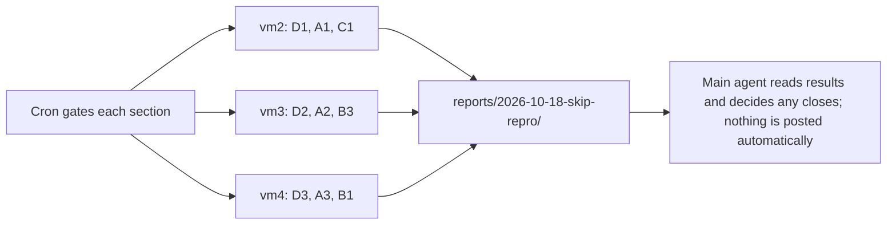

# Pool assignments: skip-audit reproductions and reviews, overnight 2026-10-18

Status: OPEN. This is one queue document. Each `##` section is one assignment with its own Status line. When cron gates a section, copy it to `assignments/` as its own file named by the section slug and post it under the usual rules in `pool/START-HERE.md`. Then set its Status line to CLAIMED or DONE in the same push as the claim or deliverable.

Source: `material/skip-audit/queue-current.json` (748 records with status `skip`). Audit verdicts on the branch cover only 38 of them (tier 2 and tier 4, audit-5 and audit-6); those 38 are left out. Earlier audit batches are not committed to the branch, so a claimant who finds a verdict for one of the other tickets should record it and skip the ticket.

Pinned head for every sweep and review: fork `origin/main` `498a09aea9` (2026-10-18). The skip notes name upstream/main at `c8ab71430f` (2026-10-17). A ticket verdict that depends on a commit between the two heads must name the commit.

## Host plan

| Host | Order | Notes |
| --- | --- | --- |
| vm2 | D1, A1, C1 | Open claims from 2026-10-16 have no heartbeat for more than two hours. This queue does not release them; the host owner does. |
| vm3 | D2, A2, B3 | Open claims: `pool-vm3-gate-backlog-16887` (00:50Z) and `pool-vm3-solr-13059-fix-round-1` (01:54Z). Finish or release these first. |
| vm4 | D3, A3, B1 | No open claims on coordination. |
| Any Linux host | B2, C2, C3, C4 | Open. Claim per WORKFLOW.md. |
| vm5 (coordinator) | Not handed off | Running SOLR-16430 (LocalFSCloudIncrementalBackupTest) and SOLR-5628 (TestDistribDocBasedVersion with the workaround line removed). Claim `pool-vm5-skip-repro-16430-5628-round-1`. |

Deferred, not assigned: 180 `awaitsfix/design` tickets with no named test (these are design items, not reproduction questions), and 11 `admin-ui` tickets (the Selenium suites run on the Windows host only).

## Common rules

- Sweep sections use one Gradle build at a time under the shared lock. Review sections run no builds.
- Results go into the deliverable as they finish. A stop keeps the partial results.
- Nothing is closed, commented, or posted to JIRA or GitHub from this queue.

## Assignment files

- `assignments/pool-skip-repro-8380-round-1.md`: D1. Reproduce SOLR-8380 (CollectionsAPIDistributedZkTest 500 on proxied request), round 1
- `assignments/pool-skip-repro-14159-round-1.md`: D2. Reproduce SOLR-14159 (TestCloudConsistency connection failures), round 1
- `assignments/pool-skip-repro-5516-round-1.md`: D3. Reproduce SOLR-5516 (ChaosMonkeyNothingIsSafeTest), round 1
- `assignments/pool-skip-repro-flake-round-1.md`: A1. Reproduce flake tickets with named test classes, round 1
- `assignments/pool-skip-repro-flake-locate-round-1.md`: A2. Locate and reproduce flake tickets without a named class, round 1
- `assignments/pool-skip-repro-other-round-1.md`: A3. Reproduce non-flake tickets with named test classes, round 1
- `assignments/pool-skip-review-removed-round-1.md`: B1. Verify removed-feature tickets, round 1
- `assignments/pool-skip-review-removed-round-2.md`: B2. Verify removed-feature tickets, round 2
- `assignments/pool-skip-review-committed-support-round-1.md`: B3. Verify already-committed and support-question tickets
- `assignments/pool-skip-review-stale-slice-1.md`: C1. Verify stale tickets without a named test, slice 1 of 4
- `assignments/pool-skip-review-stale-slice-2.md`: C2. Verify stale tickets without a named test, slice 2 of 4
- `assignments/pool-skip-review-stale-slice-3.md`: C3. Verify stale tickets without a named test, slice 3 of 4
- `assignments/pool-skip-review-stale-slice-4.md`: C4. Verify stale tickets without a named test, slice 4 of 4
